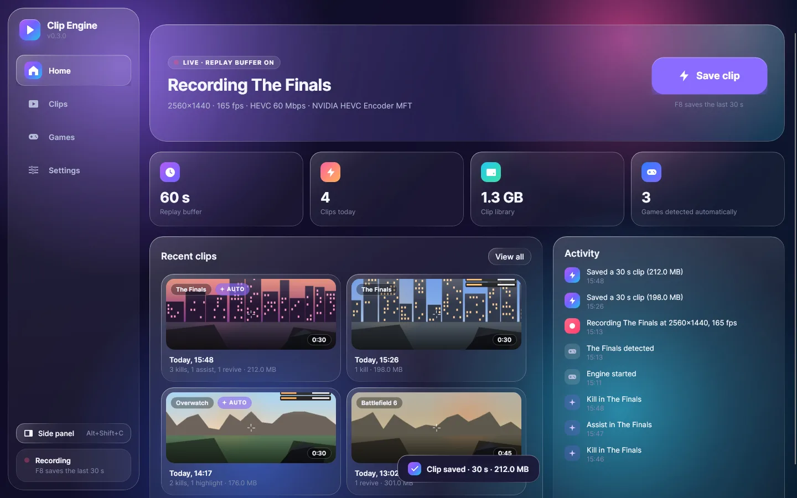
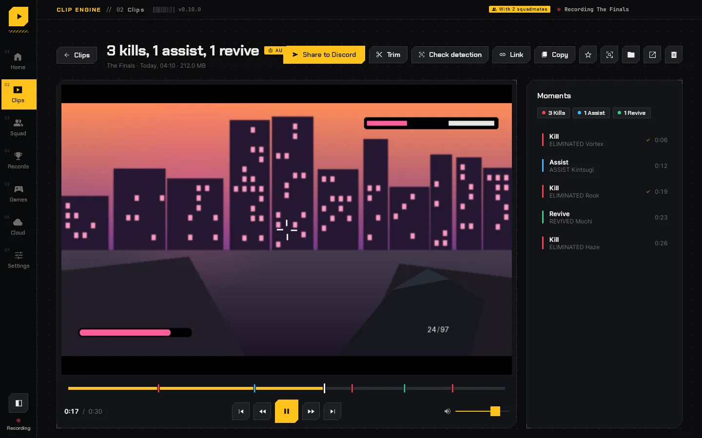
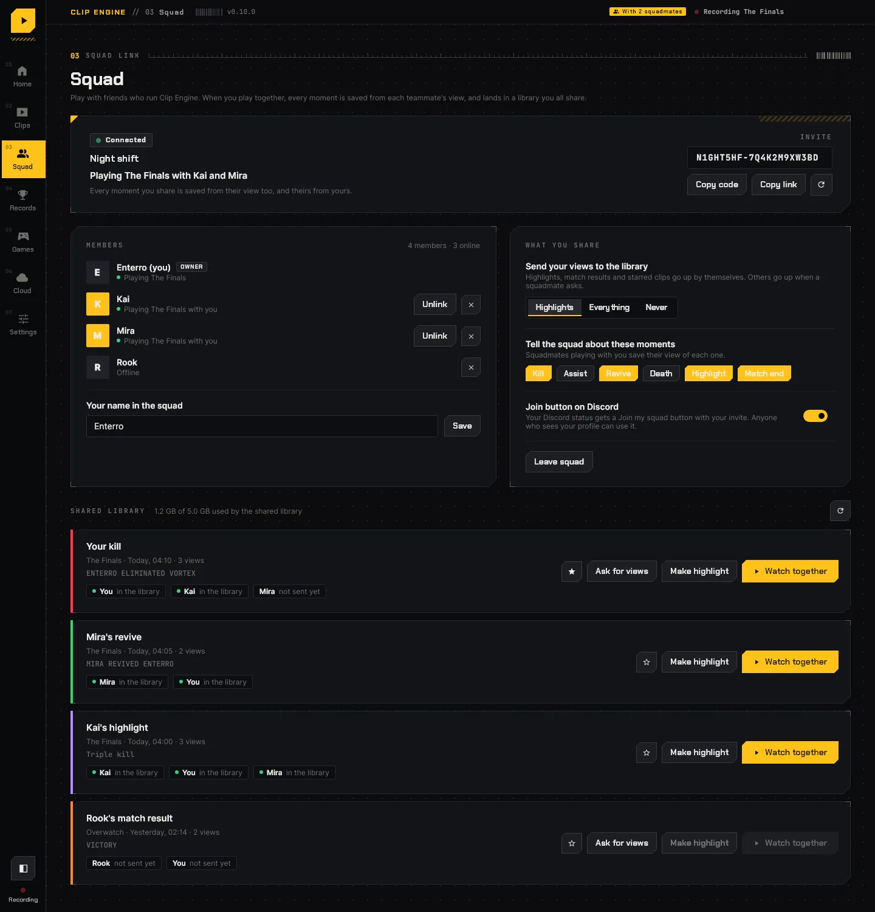

<h1 align="center">Clip Engine</h1>

<b>Free game clipping for Windows that saves your best plays by itself.</b> 
Kills, clutches, revives and wins are spotted as they happen and clipped for you, with every moment marked.

  <a href="https://github.com/MochiBoy9/Clip_Engine/releases/latest/download/Clip_Engine-Setup.exe"><b>Download for Windows</b></a> ·
  <a href="https://mochiboy9.github.io/Clip_Engine/">Website</a> ·
  <a href="../../releases">All releases</a>

## Getting started

1. [Download the installer](https://github.com/MochiBoy9/Clip_Engine/releases/latest/download/Clip_Engine-Setup.exe) and run it. It installs for your Windows account only, with no admin prompt, and adds Clip Engine to the Start menu. If Windows says the app is from an unknown publisher, choose **More info**, then **Run anyway**. Prefer no installing? Get the [portable zip](https://github.com/MochiBoy9/Clip_Engine/releases/latest/download/Clip_Engine-windows-x64.zip), unzip it anywhere and run `ClipEngine.exe`.
2. Launch a game. Clip Engine notices it and starts recording on the screen the game is on.
3. Play. Moments are clipped by themselves, and **F8** saves the last 30 seconds whenever you like. **F9** starts a long recording.

Clips go to `Videos\Clip_Engine\<Game>`. Nothing is injected into the game, so it's safe with anti-cheat.

You need Windows 10 (version 1903 or newer) or Windows 11, and a graphics card with a video encoder, which practically every NVIDIA, AMD or Intel GPU from the last ten years has.

## What it does

- **Clips itself.** Kills, assists, deaths, revives, multi-kills, match starts and results are found from the game's own live data where it has it, and otherwise by reading the HUD. A clip is saved around each one, with its moments on the timeline.
- **Clip keys your way.** F8 saves the last 30 seconds; add more keys that each save their own length, and give each game its own set.
- **Say "clip that".** Turn on voice clips and say a phrase you pick to save the last moments, with no key to reach for. Windows' own speech recognition listens on your PC; nothing you say leaves it.
- **Audio on its own tracks.** The game, your mic, Discord and other apps each get a track, after one with everything mixed that every player plays. Turn any of them down or mute it from Settings, even mid-game.
- **Up to 30 minutes of replay.** Keep as much as half an hour ready to save. Settings shows the memory it takes and warns you when your PC would struggle.
- **Long recordings.** Record a whole session with F9; every moment is still marked.
- **Records.** Lifetime kills, deaths, K/D and wins, personal bests in every game, and the current match against your best, live.
- **Journal.** For extraction and co-op games, Clip Engine keeps a field journal of every run: the map and conditions you picked (and the times you backed out), what you took in, each enemy you took down, what you found, whether you made it out or died and everything you lost when you did, and the XP from the results screen. Each run is told as a short story in the game's own words, with your shortest and longest runs, most enemies, best streak and how you do on each map. PvP kills the screen doesn't show can be added by hand with + and −. Turn it off in Settings if you'd rather not.
- **Squads.** Make a squad and send friends the invite. Every moment one of you gets is saved from everyone's view, lined up to the moment. Watch up to four views side by side, or cut them into one highlight.
- **Friends.** Add friends by username or friend code, see who's online, what they're playing and for how long, get a notice when they come on, and right-click to join their squad.
- **Share anywhere.** One click puts a short link on your clipboard. It plays in any browser, with the moments marked, and shows a preview in Discord. A small copy that fits Discord's upload limit is a click away too.
- **Your profile.** Public clips show on your page, pinned ones first, under the same username your friends know you by.
- **The hub.** Everyone's public clips on the web, newest or most watched, by game, and searchable. Watching needs no account, and nothing goes there unless you set it to Public. Sign in from your phone or any browser with one click in the app (or a username and password you set) to change who can see each clip.
- **Your badge, your call.** Pro, Ultra and Content Creator badges show next to your name. Hide yours any time from the app or the hub.
- **Trim, edit, star and tidy.** Trim a clip in the player with no quality lost, or open it in the editor to split it into parts, cut what you don't need, put parts in another order and export a new clip with its moments kept. Star favourites, and have old clips cleaned up by age or size, favourites always kept.
- **Detection Studio.** Add any game, or fine-tune how one is read: draw a box where the game shows a kill, type the words, and test it on your own clips.
- **FPS and PC stats.** Turn on the stats overlay (Alt+Shift+F) for a slim strip in a corner of the game: frame rate, 1% lows, CPU, GPU and its temperature, video memory and RAM, turning yellow then red when something holds the game back. It reads what Windows already measures, never touches the game (so anti-cheat has nothing to object to), and never shows up in your clips. The FPS counter needs Windows' permission once; Settings asks for it.
- **Light on your game.** Encodes on the GPU at your monitor's resolution and refresh rate, and records only the game, so nothing else on your PC ends up in a clip.
- **Discord status.** Shows the game, the match time and your kills while you play.

Every clip made with Clip Engine says so in its file details, with a link back here, and clips you share from the cloud carry a small, see-through Clip Engine mark in the corner of the player. A shared link's preview in Discord says it was clipped with Clip Engine, with a link to get it.

  
  

## Supported games

| Game | How moments are found |
| --- | --- |
| Counter-Strike 2 | Official Game State Integration: kills (with headshots and weapon), assists, deaths, 3K/4K/ACE rounds, round MVPs, match start and result |
| Dota 2 | Official Game State Integration: kills, deaths, assists, multi-kills, the horn and the match result |
| League of Legends | Official Live Client Data API: kills, deaths, assists, multi-kills, aces, first blood, dragons, Baron and steals, game start and result |
| Rocket League | Official Stats API: goals, assists, demolitions, saves, kickoff and the match result |
| Team Fortress 2 | Its console log, which names every kill: your kills (with the weapon and crits) and deaths, exactly; the killfeed is read until the log starts |
| Valorant, Marvel Rivals, Rainbow Six Siege, Delta Force, Deadlock, Halo Infinite, Paladins, Splitgate | The killfeed, by your in-game name (set it on the Games page), plus round and match banners and medals |
| The Finals | Kills and deaths from the killfeed by your in-game name, backed up by the score line and the elimination chime, so each counts once; assists, revives and match messages from the HUD |
| Battlefield 6, 2042, V, 1 and 4 | The KILL line under the crosshair and the killfeed by your name, counted once between them; assists, revives, deaths and match results from the HUD |
| Halo: The Master Chief Collection | "You killed ..." and "... killed you" in the corner, medals and the end of the game; no in-game name needed |
| Overwatch, Fortnite, Apex Legends, PUBG, Call of Duty | The HUD's kill, death, revive and match messages |
| ARC Raiders | The journal: the map and conditions you pick, queueing and deploying, ARC destroyed (from the XP lines), raiders downed, loot, your inventory, and whether you extracted or died, with the XP from the results; the death and extraction screens are clipped |
| Hunt: Showdown 1896 | The journal, from the match summary the game saves after each match: the mode, monsters and bosses killed, hunters killed, bounties, XP and whether you extracted |
| Escape from Tarkov | The journal: the location picked, queueing, deploying, and Survived, Killed in action or Left the raid, with the XP; the end of each raid is clipped |
| Helldivers 2, Deep Rock Galactic | The journal: the mission, enemies killed where the game counts them, and whether it was a success or failed; the end of each mission is clipped |
| Roblox, Minecraft | Recorded, with clips on the hotkey; add rules for the experiences you play in Detection Studio |

Kill clips are only offered for games that say plainly on screen when you get a kill or die, since that's what makes them dependable. Extraction games like ARC Raiders and Escape from Tarkov keep kills off the screen, so they get the journal instead, with their death and extraction screens clipped; the journal's screen rules are a first pass and get tuned against real gameplay like the rest. Detection Studio can add any other game, such as Destiny 2, with your own rules.

The official events are exact and work whatever the HUD looks like. Clip Engine turns them on by itself: it writes a `gamestate_integration_clipengine.cfg` into CS2's and Dota 2's `cfg` folders, sets `PacketSendRate` in Rocket League's `TAGame\Config\DefaultStatsAPI.ini` and adds a `con_logfile` line to Team Fortress 2's `tf\cfg\autoexec.cfg`, for installs it finds through Steam and the Epic Games launcher and for any game it sees running. If a HUD or config in `tf\custom` has its own `autoexec.cfg`, add `-condebug` to Team Fortress 2's launch options instead. A game that was already open needs one restart to pick that up. Dota 2 may also need `-gamestateintegration` in its Steam launch options. League's API is always on during a game.

Screen rules for the rest are a first pass and get tuned against real gameplay; see `detection.ini` below. For a HUD that shows a kill as an icon rather than words, a rule can look for a picture of the icon cut from a screenshot instead. Screen reading stays light: a box inside another is read with it when that is cheaper, a box that has not changed is not read again, and death screens and match banners are checked less often than kill popups. Valorant has no local events API, so it is read off the screen like the others.

## Plans

Clip Engine is free. Subscriptions add more for people who want it:

| | Free | Pro ($2.99 a month) | Ultra ($4.99 a month) |
| --- | --- | --- | --- |
| Recording | Up to 1080p | Up to 1440p | Up to 4K |
| Cloud library | 2 GB | 100 GB | 250 GB |
| Username changes | Once a month | Once a week | Once a week |
| Extras | | Colour themes, a badge, a name in the credits | Every theme, a badge, a name at the top of the credits |

Subscribe from the [website](https://mochiboy9.github.io/Clip_Engine/#plans) and paste the key you're emailed into **Settings > Plan**.

Or get Pro free: invite friends from the **Friends** page. When three of them install Clip Engine on their own PC and start it, you get a month of Pro. Each friend has to be on a PC and an internet connection of their own, so a second PC at home doesn't count.

## Privacy

Clips stay on your PC unless you share them. The first time Clip Engine starts on a PC it tells the online service so, with a hashed id for the PC, so friends who invited you get credit. Voice clips are off until you turn them on, and are heard by Windows' speech recognition on your PC, not sent anywhere. The cloud library, squads and friends need a free cloud account, which asks for no email. Online, the service keeps only what those features need: the clips you upload, your username, your friends and squads, and whether you're online. See the [privacy notice](website/privacy.html).

## Help and feedback

Found a bug or have an idea? [Open an issue](../../issues). Logs that help: `%LOCALAPPDATA%\Clip_Engine\clip_engine.log`.

## License

Clip Engine is free to download and use, but it is not open source. The source code is shared here so you can see how it works; copying, changing or redistributing it isn't allowed. See [LICENSE](LICENSE).
